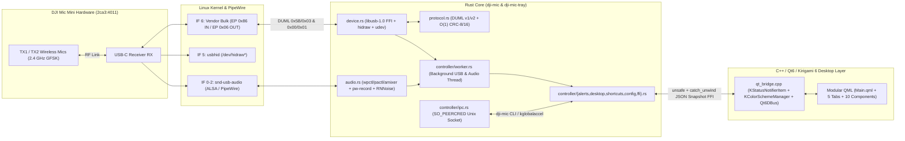

<div align="center">


# KDE DJI Mic Mini Control (`dji-mic-mini-kde`)

**Native Rust + KDE Plasma 6 / Kirigami System Tray, Live DUML v1/v2 USB Telemetry, AI Room Noise Learning, Hardware Controller & CLI for DJI Mic Mini (`2ca3:4011`)**

[](https://github.com/russellmilliner/dji-mic-mini-kde/releases/tag/v0.2.5)
[](https://github.com/russellmilliner/dji-mic-mini-kde/releases)
[](LICENSE)
[](https://kde.org/)
[](src/protocol.rs)
[](https://ko-fi.com/russellmilliner)

</div>

---

## Overview

When the **DJI Mic Mini USB-C Receiver (`2ca3:4011`)** is plugged into a Linux system, it enumerates as a composite USB Audio Class (`snd-usb-audio`), CDC ACM virtual serial, Vendor HID (`usbhid` / `/dev/hidraw*`), and Vendor Bulk (`Interface 6: EP 0x86 IN / EP 0x06 OUT`) device. Without host activation and framing support, standard Linux desktops cannot display transmitter battery levels, toggle receiver/transmitter DSP parameters, or monitor wireless link drops:

1. **Passive Receiver Activation**: The receiver transmits 6-byte Apple iAP2 sync frames (`ff 55 02 00 ee 10`) until the host initiates **DUML telemetry polling** (`0x00/0x01` GetVersion and `0x04/0x74` keepalive) over USB Interface 6 (`EP 0x06 OUT`).
2. **DUML `v1` (`01.01.00.56`) & `v2` Frame Decoding**: Decodes both newer `01.01.00.56` `v1` heartbeats (compact `27-byte` TX blocks with a 7-step battery gauge encoded in bits `2..4`) and `v2` packets, with O(1) lookup-table CRC-8 and CRC-16 verification (`0xB92D` `v1` residue XOR).

**KDE DJI Mic Mini Control** implements the entire telemetry stack, CLI (`dji-mic`), background daemon (`dji-mic-tray`), and 5-tab Kirigami desktop UI natively in **Rust + C++/Qt6**, claiming only USB Interface 6 via `libusb-1.0` so Linux audio (`snd-usb-audio` / PipeWire) keeps running uninterrupted.

---

## Key Features

- **5-Tab KDE Plasma 6 / Kirigami Control Center (`dji-mic-tray`)**:
  - **Tabs**: `Overview & Telemetry`, `Hardware Controls`, `USB & Protocol Inspector`, `Alerts, udev & Settings`, and `About`, enclosed in a unified bordered container directly attached to a standard `QQC2.TabBar`.
  - **Plasma Integration**: Dynamic version readout in window title bar and header, OS theme and accent color synchronization via `KColorSchemeManager` (`system`, `dark`, `light`), OS-scaled typography, `HighContrastScrollBar`, bottom status bar zoom (`75%`–`175%` with `Ctrl++`, `Ctrl+-`, `Ctrl+0`, and `Ctrl+Wheel`), and a C++ `REL_WHEEL_HI_RES` high-resolution wheel scroll filter for Ploopy trackballs/knobs.
- **Hardware-Aware `KStatusNotifierItem` Tray Icon**:
  - Dynamically renders the transmitter battery percentage badge (`100%` down to `5%`), VU activity indicator, or disconnect warning (`!`) with cached `QIcon` rasterization.
  - Uses `KStatusNotifierItem` (`Category = Hardware`), switching automatically between `Active` (shown on the panel when a TX is linked, an app is recording from DJI Mic Mini, or the AI virtual mic is active) and `Passive` (tucked into the hidden tray drawer when idle).
- **AI Noise Cancellation & 3-Second Room Noise Learning**:
  - Captures a 3-second 48 kHz calibration snippet via `pw-record --raw` (avoiding ALSA `EBUSY` conflicts when apps already hold the mic), analyzes noise floor with `librnnoise.so.0` and a 4-band spectral FFT profiler (`<150 Hz`, `150–400 Hz`, `400–2500 Hz`, `>2500 Hz`), writes a sanitized PipeWire `filter-chain` config (`learned-rnnoise-filter.conf` for virtual mic `dji_mic_mini_ai_nc_source`), and calibrates TX Noise Cancellation (`Basic`/`Strong`), `150 Hz` Low-Cut filter, and Clip Limiter.
- **KDE Notifications 6 & 15 Global Keyboard Shortcuts**:
  - Ships `dji-mic-tray.notifyrc` with **9 individually configurable notification events** in KDE System Settings → Notifications and sends native notifications over `Qt6DBus` (`org.freedesktop.Notifications`).
  - Registers **15 actions in `org.kde.kglobalaccel`** (`Activate` + 14 `[Desktop Action]` shortcuts) so every key feature—battery popup, mute, NC modes, AI room noise learning, low-cut, limiter, stereo/mono, safety track, LEDs—can be bound to custom KDE global hotkeys.
- **Start on Login & Start Minimized**:
  - Persists preferences in `$XDG_CONFIG_HOME/dji-mic-tray/config.json` (`0600` atomic writes), automatically manages `~/.config/systemd/user/dji-mic-tray.service` (`--minimized` flag sync) with XDG autostart fallback, and applies every setting immediately.
- **Built-in `udev` Rule Inspector & Polkit Installer**:
  - Verifies `/etc/udev/rules.d/99-dji-mic.rules`, `/dev/bus/usb/<bus>/<dev>`, and `/dev/hidraw*` write permissions (`0660` + `uaccess`) in both GUI and CLI (`dji-mic udev --check` / `sudo dji-mic udev --install` / GUI `pkexec` installer).

---

## Architecture



---

## Installation

> [!IMPORTANT]
> Non-root USB and HID access requires `/etc/udev/rules.d/99-dji-mic.rules` on your Linux host (even when running the Flatpak). See [USB & HID `udev` Permissions](#usb--hid-udev-permissions-0660--uaccess) below.

### Option 1: Official KDE Plasma 6 Flatpak (`io.github.russellmilliner.DjiMicMiniControl`)

Built inside `org.kde.Sdk//6.11` with `org.freedesktop.Sdk.Extension.rust-stable` against `org.kde.Platform//6.11`. Download the latest `.flatpak` bundle (and `.sha256` checksum) from [GitHub Releases](https://github.com/russellmilliner/dji-mic-mini-kde/releases):

```bash
sha256sum -c dji-mic-mini-kde-v0.2.5-x86_64.flatpak.sha256
flatpak install --user -y dji-mic-mini-kde-v0.2.5-x86_64.flatpak
flatpak run io.github.russellmilliner.DjiMicMiniControl --show
```

### Option 2: Prebuilt Linux Release Archive (`.tar.gz`)

Download `dji-mic-mini-kde-v0.2.5-linux-x86_64.tar.gz` from [GitHub Releases](https://github.com/russellmilliner/dji-mic-mini-kde/releases), verify the checksum, and run `./scripts/install.sh` (installs `dji-mic` & `dji-mic-tray` into `~/.local/bin/`, modular QML & assets into `~/.local/share/dji-mic-mini-kde/`, desktop actions, `.notifyrc`, and enables `systemd --user` service `dji-mic-tray.service`):

```bash
sha256sum -c dji-mic-mini-kde-v0.2.5-linux-x86_64.tar.gz.sha256
tar -xzf dji-mic-mini-kde-v0.2.5-linux-x86_64.tar.gz
cd dji-mic-mini-kde-v0.2.5-linux-x86_64
./scripts/install.sh
```

### Option 3: Build & Install from Source

#### System Build Dependencies

| Distribution | Required Packages |
| :--- | :--- |
| **Arch / EndeavourOS** | `rust` `cargo` `pkgconf` `clang` `qt6-base` `qt6-declarative` `qt6-tools` `kirigami` `kstatusnotifieritem` `kcolorscheme` `libusb` |
| **Fedora Workstation / KDE** | `rust` `cargo` `pkgconf-pkg-config` `gcc-c++` `qt6-qtbase-devel` `qt6-qtdeclarative-devel` `kf6-kirigami-devel` `kf6-kstatusnotifieritem-devel` `kf6-kcolorscheme-devel` `libusb1-devel` |
| **Debian / Kubuntu / Ubuntu** | `rustc` `cargo` `pkg-config` `g++` `qt6-base-dev` `qt6-declarative-dev` `qt6-base-dev-tools` `libkf6statusnotifieritem-dev` `libkf6colorscheme-dev` `qml6-module-org-kde-kirigami` `libusb-1.0-0-dev` |

Runtime audio & desktop helpers (standard on KDE Plasma 6): `pipewire`, `wireplumber`, `pipewire-pulse`, `alsa-utils`, `polkit` (`pkexec`), and `librnnoise` (optional, for AI Room Noise Learning virtual mic).

```bash
git clone https://github.com/russellmilliner/dji-mic-mini-kde.git
cd dji-mic-mini-kde
./scripts/install.sh
```

---

## USB & HID `udev` Permissions (`0660` + `uaccess`)

Check rule and device node permissions:

```bash
dji-mic udev --check
```

Install `/etc/udev/rules.d/99-dji-mic.rules` via CLI (or click **"Install / Repair udev Rule (Polkit)"** in the GUI's `Alerts, udev & Settings` tab):

```bash
sudo dji-mic udev --install
```

The embedded rule (`99-dji-mic.rules`) grants local console-session read/write access without world-writable `0666` permissions:

```udev
# DJI Mic Mini / Mic 2 / Mic 3 — non-root USB (libusb) and HID (/dev/hidraw*) access
SUBSYSTEM=="usb", ATTR{idVendor}=="2ca3", ATTR{idProduct}=="4011", MODE="0660", TAG+="uaccess"
SUBSYSTEM=="hidraw", ATTRS{idVendor}=="2ca3", ATTRS{idProduct}=="4011", MODE="0660", TAG+="uaccess"
```

---

## CLI Reference (`dji-mic` & `dji-mic-tray`)

### `dji-mic` Subcommands

When `dji-mic-tray` is already running, `dji-mic status` and `dji-mic set` automatically route requests over the authenticated Unix IPC socket so USB Interface 6 is never contended.

| Command | Arguments / Flags | Description |
| :--- | :--- | :--- |
| `dji-mic status` | `[--json]` | Full hardware, USB topology, `udev`, RX/TX battery & VU, DUML settings, and PipeWire/ALSA report |
| `dji-mic watch` | `[--interval SEC] [--json]` | Live terminal telemetry stream (`0.05s` minimum interval, default `0.25s`) |
| `dji-mic set` | `<setting> [value] [--tx 1\|2]` | Apply a verified DJI Mic Mini hardware setting (run `dji-mic set` with no args to list all 13 settings) |
| `dji-mic mute` | `[on\|off\|toggle]` | Mute, unmute, or toggle Linux ALSA/PipeWire capture mute |
| `dji-mic volume` | `[0-100%\|+5%\|-5%]` | Get or set Linux ALSA/PipeWire capture volume (validates numeric/relative syntax) |
| `dji-mic udev` | `[--check\|--print-rule\|--install] [--json]` | Check rule state, print `99-dji-mic.rules`, or install/reload `/etc/udev/rules.d/99-dji-mic.rules` |
| `dji-mic raw` | `--cmd-id HEX [--cmd-set HEX] [--payload HEX] [--dialect v1\|v2]` | Send a validated hex DUML frame over Interface 6 and print decoded replies |

### Supported Hardware Settings (`dji-mic set <setting> [value]`)

| Setting | Target | Dialect | Allowed Values | Description |
| :--- | :--- | :--- | :--- | :--- |
| `noise-cancel` | `TXAll` | `v1` / `v2` | `basic` \| `strong` | Active Noise Cancellation strength |
| `noise-cancel-power` | `TXAll` | `v2` | `on` \| `off` | Noise Cancelling power state |
| `noise-cancel-button` | `TXAll` | `v2` | `on` \| `off` | Toggle Noise Cancellation via TX Power Button |
| `low-cut` | `TXAll` | `v1` / `v2` | `on` \| `off` | `150 Hz` high-pass wind/rumble filter |
| `stereo` | `RX` | `v1` / `v2` | `mono` \| `off` \| `stereo` \| `on` | Receiver audio track channel routing |
| `safety-track` | `RX` | `v1` / `v2` | `on` \| `off` | Dual-mono `-6 dB` backup safety track on right channel |
| `clip-limiter` | `RX` | `v1` / `v2` | `on` \| `off` | Automatic hardware clipping limiter |
| `auto-off-15m` | `RX` | `v1` / `v2` | `on` \| `off` | Receiver 15-minute inactivity auto power-off |
| `tx-auto-off-15m` | `TXAll` | `v2` | `on` \| `off` | Transmitter 15-minute inactivity auto power-off |
| `camera-power` | `RX` | `v1` / `v2` | `on` \| `off` | Auto power on/off synced with host/camera USB power |
| `plug-free` | `RX` | `v1` / `v2` | `on` \| `off` | Allow external speaker playback while receiver stays plugged in |
| `mic-leds` | `TXAll` | `v1` / `v2` | `on` \| `off` | Transmitter status indicator LEDs |
| `voice-tone` | `TXUnit` | `v2` | `standard` \| `rich` \| `bright` | Per-transmitter (`--tx 1\|2`) voice tone EQ preset |

### `dji-mic-tray` Daemon & Shortcut Flags

| Flag | Action |
| :--- | :--- |
| `--show` / `--toggle` / `--minimized` | Show window, toggle visibility, or launch minimized to system tray |
| `--status` | Query the running daemon over Unix IPC (or fall back to `dji-mic status --json`) |
| `--ui-test` | Offscreen Kirigami geometry & overflow self-test across window sizes, tabs, themes, and zoom levels |
| `--popup-status` | Trigger an instant on-demand battery & link status notification |
| `--toggle-mute` | Toggle system microphone mute |
| `--toggle-nc` / `--nc-basic` / `--nc-strong` | Toggle HW noise cancelling or switch directly to `basic` / `strong` |
| `--cycle-ai-nc` / `--toggle-virtual-mic` / `--learn-noise` | Cycle AI NC mode, toggle PipeWire AI virtual mic, or run 3s Room Noise Learning |
| `--toggle-low-cut` / `--toggle-limiter` / `--toggle-stereo` / `--toggle-safety` / `--toggle-leds` | Toggle RX/TX hardware DSP and LED switches |

---

## KDE Plasma 6 Notifications & Global Shortcuts

### KDE Notifications (`dji-mic-tray.notifyrc`)

Installed automatically to `~/.local/share/knotifications6/dji-mic-tray.notifyrc` (and `/app/share/knotifications6/dji-mic-tray.notifyrc` in Flatpak). Customize popup style, sound, or Do Not Disturb behavior per event in **System Settings → Notifications → Applications → KDE DJI Mic Mini Control**:

| Event ID | Event Name | Default Urgency | Trigger |
| :--- | :--- | :--- | :--- |
| `rxDisconnected` | USB Receiver Disconnected Alert | Critical | Receiver `2ca3:4011` unplugged or missing at startup |
| `rxConnected` | USB Receiver Connected | Normal | Receiver `2ca3:4011` plugged in |
| `txDisconnected` | Wireless Transmitter Disconnected Alert | Critical | All wireless TX units disconnect while RX is plugged in |
| `txConnected` | Wireless Transmitter Connected | Normal | TX1 or TX2 links with the receiver |
| `lowBattery` | Transmitter Low Battery Alert | Critical | TX battery drops at or below configured threshold (default `25%`) |
| `micMuteChanged` | Microphone Mute & Hardware Setting Changed | Low | Global shortcut or action toggles mute or hardware state |
| `noiseProfileLearned` | AI Room Noise Profile Learned | Low | 3-second RNNoise + spectral calibration finishes |
| `telemetrySummary` | On-Demand Telemetry & Battery Summary | Normal | `Show Receiver & Transmitter Battery Notification` shortcut |
| `alertTest` | Manual Alert Test | Normal | Test notification from Settings or System Tray menu |

### KDE Global Shortcuts (`org.kde.kglobalaccel`)

Installed via `~/.local/share/applications/dji-mic-tray.desktop` (1 primary `Activate` entry + 14 `[Desktop Action]` entries). Bind any key combination in **System Settings → Keyboard → Shortcuts → KDE DJI Mic Mini Control**:

- `Activate` (`dji-mic-tray --show`) & `Toggle DJI Mic Mini Control Window` (`--toggle`)
- `Show Receiver & Transmitter Battery Notification` (`--popup-status`)
- `Toggle DJI Mic Mini System Microphone Mute` (`--toggle-mute`)
- `Toggle Hardware Noise Cancellation On/Off` (`--toggle-nc`)
- `Set Hardware Noise Cancellation: Basic (Indoor)` (`--nc-basic`) & `Strong (Noisy)` (`--nc-strong`)
- `Cycle AI Noise Cancellation Mode (Off / HW / Learned AI / Adaptive)` (`--cycle-ai-nc`)
- `Toggle PipeWire AI Denoised Virtual Microphone` (`--toggle-virtual-mic`)
- `Start 3-Second AI Room Noise Learning` (`--learn-noise`)
- `Toggle 150 Hz Low-Cut Wind/Rumble Filter` (`--toggle-low-cut`)
- `Toggle Hardware Auto Clip Limiter` (`--toggle-limiter`)
- `Toggle Audio Track Mode (Mono / Stereo)` (`--toggle-stereo`)
- `Toggle -6 dB Safety Backup Track` (`--toggle-safety`)
- `Toggle Transmitter Status LEDs On/Off` (`--toggle-leds`)

---

## Security & Performance Architecture

- **Least-Privilege Device Access (`0660` + `uaccess`)**: `99-dji-mic.rules` restricts raw USB and `/dev/hidraw*` nodes to the active console user session (`TAG+="uaccess"`), and the GUI udev installer executes `pkexec sh -c` directly with the compile-time embedded rule—never executing user-writable binaries as root.
- **No Shell Injection & Bounded Subprocesses**: Every external helper (`wpctl`, `pactl`, `amixer`, `pw-record`, `udevadm`, `systemctl`) runs without a shell (`Command::new(...)`), uses input validators (`is_valid_volume_spec`, hex parsers), drains pipes with strict wall-clock timeouts (`run_command_with_timeout`), and reaps detached children (`spawn_reaped`).
- **Closed HID Command Allowlist (`SAFE_HID_COMMANDS`)**: Only verified audio/display settings in `SETTINGS_SPEC` are exposed; destructive firmware commands stay isolated from normal setting handlers.
- **Strict DUML Framing & O(1) CRC Verification**: `decode_frame` requires valid CRC-8 header and valid `v1` or `v2` CRC-16 frame checksums (rejecting corrupted frames), uses wrapping `u16` sequence IDs, and checks negative `libusb_bulk_transfer` return codes.
- **Hardened Rust ↔ C++/Qt FFI**: Pointer-taking `extern "C"` entry points are `unsafe` and wrapped in `std::panic::catch_unwind` with poison-safe mutex guards (`lock_unpoisoned`), `QPointer` / `std::atomic` lifetime guards across Qt event dispatch, and a single-shot cached `rust_get_ui_snapshot_json()` snapshot paired with granular Qt signals.
- **Non-Blocking USB Worker & Authenticated IPC**: All USB I/O, PipeWire/ALSA probes, and hardware writes execute on a dedicated `dji-usb-worker` thread; the `SO_PEERCRED`-verified `0600` Unix socket (`$XDG_RUNTIME_DIR/dji-mic-tray.sock`) uses non-blocking `poll()`, I/O timeouts, and a concurrency cap; config/PipeWire files use atomic `tempfile + rename` writes (`0600` / `0644`) with sanitized comment lines.

---

## Development, Testing & Flatpak Packaging

Run static analysis (`clippy -D warnings`) and the full unit + integration test suite (including CRC-8/16 round-trips, DUML `v1`/`v2` decoding, CLI input rejection tests, source security checks, and headless `--ui-test` layout overflow checks across all 5 tabs, themes, and zoom levels):

```bash
cargo clippy --all-targets -- -D warnings
cargo test
```

Run the headless Kirigami layout inspector directly:

```bash
QT_QPA_PLATFORM=offscreen DJI_MIC_APP_DIR="$PWD" ./target/release/dji-mic-tray --ui-test
```

Build the self-contained KDE Plasma 6 Flatpak bundle inside `org.kde.Sdk//6.11`:

```bash
./scripts/build-flatpak.sh
```

---

## Author & Support

- **Author**: **Russell Milliner** ([@russellmilliner](https://github.com/russellmilliner))
- **Repository**: [github.com/russellmilliner/dji-mic-mini-kde](https://github.com/russellmilliner/dji-mic-mini-kde)
- **Changelog**: [CHANGELOG.md](CHANGELOG.md)
- **Support**: If this project helps your workflow, consider supporting development on [Ko-fi (`ko-fi.com/russellmilliner`)](https://ko-fi.com/russellmilliner).
