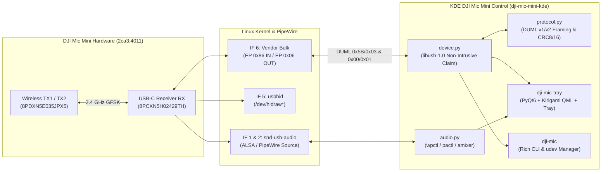

<div align="center">

# KDE DJI Mic Mini Control (`dji-mic-mini-kde`)

**KDE Plasma 6 / Kirigami System Tray, Live DUML v1/v2 USB Telemetry, Hardware Controller & Desktop Alert Daemon for the DJI Mic Mini (`2ca3:4011`)**

[](LICENSE)
[](https://kde.org/)
[](https://www.python.org/)
[](protocol.py)
[](https://ko-fi.com/russellmilliner)

</div>

---

## Overview

When the **DJI Mic Mini Receiver (`2ca3:4011`)** is connected to Linux over USB-C, it enumerates as a composite USB Audio Class + iAP2/DUML Bulk Interface (`Interface 6: EP 0x86 IN / EP 0x06 OUT`) + Vendor HID (`Interface 5`) device. However, two limitations prevent standard Linux desktops from seeing wireless transmitter telemetry or battery levels:

1. **Passive Receiver Mode**: The receiver only outputs `6-byte` Apple iAP2 sync frames (`ff 55 02 00 ee 10`) until the host sends a **DUML activation / status request** (`CmdSet 0x02 / CmdID 0x59` or `0x00 / 0x01`) over USB Interface 6 (`EP 0x06 OUT`).
2. **Firmware `01.01.00.56` (`v1` Dialect) Compact Layout**: Newer DJI Mic Mini receivers use a compact `63-byte` `0x5B/0x03` heartbeat payload where each connected transmitter is encoded in a `27-byte` block with a 7-step battery gauge in `flags_byte` bits `2..4` (`(flags >> 2) & 0x07`).

**KDE DJI Mic Mini Control** solves both problems natively without detaching the Linux USB Audio driver (`snd-usb-audio`), providing a full **KDE Plasma 6 / Kirigami** desktop control center, live system tray battery badge, desktop disconnect/low-battery notifications, PipeWire/ALSA capture controls, and a rich CLI (`dji-mic`).

---

## Key Features

- **Dynamic KDE Plasma 6 System Tray & Task Manager Icon**:
  - Live-rendered 64×64 vector microphone + wireless wave icon with real-time TX battery percentage pill (`100%`, `85%`, etc.) or red `!` disconnect badge.
  - Synchronizes the rendered icon to `~/.local/share/icons/hicolor/` and sets `QGuiApplication.setDesktopFileName("dji-mic-tray")` so the **KDE Task Manager** displays the exact same microphone icon.
- **Complete DUML `v1` & `v2` Telemetry**:
  - **Transmitters (TX1 & TX2)**: Battery `%` (7-step gauge on `v1` or direct `0–100%` on `v2`), 4-bar indicator, serial number, firmware version, link state, Noise Cancellation state/level (`Weak` / `Strong`), Clip-Loss Prevention, Auto-Record, LED status, and 32-bit Float status.
  - **Receiver (RX)**: Model name (`DJI MIC MINI RX`), Hardware Revision (`01.00.00.00` via `0x00/0x01` GetVersion), Firmware (`01.01.00.56`), Serial number, Gain dial (`-12 dB`, `-6 dB`, `0 dB`, `+6 dB`, `+12 dB`), Track Mode (`Mono`, `Stereo`, `Mono + Safety`), Low-Cut (`150 Hz`), and Auto-Off timer.
- **Hardware & PipeWire/ALSA Controls**:
  - Adjust Receiver Gain (`-12 dB` to `+12 dB`), toggle `150 Hz` Low-Cut Filter, switch Noise Cancellation strength (`Weak` / `Strong`), and control PipeWire/ALSA capture volume & mute in real time.
- **Built-in `udev` Rule Verification & 1-Click Polkit Setup**:
  - Inspects `/etc/udev/rules.d/99-dji-mic.rules`, `/dev/bus/usb/<bus>/<dev>`, and `/dev/hidraw*` write permissions in both the GUI (`Alerts, udev & Settings` tab) and CLI (`dji-mic udev --check` / `sudo dji-mic udev --install`).
- **Desktop Popup Alerts**:
  - Instant KDE `notify-send` / system tray popup alerts when the USB receiver is unplugged, all wireless transmitters disconnect while RX is plugged in, or any transmitter battery drops below a configurable threshold (default `25%`).
- **KDE Plasma 6 UI Standards**:
  - Native `Kirigami.ApplicationWindow`, `Kirigami.Theme` colors & OS font scaling, native `QQC2.TabBar` / `QQC2.TabButton` across 5 tabs, `HighContrastScrollBar`, Ploopy high-resolution `REL_WHEEL_HI_RES` wheel scroll filter, bottom status bar zoom controls (`75%`–`175%`), and instant settings persistence.

---

## Architecture



---

## USB Interface & Protocol Reference

| Interface | Class / Driver | Endpoints | Purpose |
| :--- | :--- | :--- | :--- |
| **Interface 0–2** | `01 Audio` (`snd-usb-audio`) | `EP 0x82 IN` Isochronous | `48 kHz` 16-bit Stereo PCM Microphone Capture |
| **Interface 3–4** | `02 CDC ACM` (`cdc_acm`) | `EP 0x81 IN`, `EP 0x01 OUT` | Virtual Serial Port (`/dev/ttyACM0`) |
| **Interface 5** | `03 HID` (`usbhid`) | `EP 0x85 IN`, `EP 0x05 OUT` | Vendor HID (`64-byte` Report `0x01`, `/dev/hidraw*`) |
| **Interface 6** | `FF Vendor Specific` (`libusb`) | `EP 0x86 IN`, `EP 0x06 OUT` | **Primary DUML v1/v2 Telemetry & Control Bulk Pipe** |

### Supported Safe Control Commands (`CmdSet 0x02`)

| Command Name | `CmdSet` / `CmdID` | Values | Notes |
| :--- | :--- | :--- | :--- |
| **Receiver Gain** | `0x02` / `0x59` | `1`=`-12dB`, `2`=`-6dB`, `3`=`0dB`, `4`=`+6dB`, `5`=`+12dB` | Updates RX gain dial & streams new `0x5B/0x03` state |
| **Low-Cut Filter (`150 Hz`)** | `0x02` / `0x5E` | `0`=Off, `1`=On (`150 Hz`) | Toggles RX low-cut filter |
| **Noise Cancellation Level** | `0x02` / `0x6A` | `1`=Weak, `2`=Strong | Configures TX noise cancellation intensity |
| **GetVersion Query** | `0x00` / `0x01` | Empty payload (`cmd_type=0x40`) | Returns RX model name, HW rev (`01.00.00.00`), and FW (`01.01.00.56`) |

---

## Installation & `udev` Setup

### 1. Configure Non-Root USB Permissions (`udev`)

Check your current `udev` rule and USB device permissions:

```bash
dji-mic udev --check
```

Install the `udev` rule (`/etc/udev/rules.d/99-dji-mic.rules`) via CLI or click **"Install / Repair udev Rule (Polkit)"** inside the GUI (`Alerts, udev & Settings` tab):

```bash
sudo dji-mic udev --install
```

This creates `/etc/udev/rules.d/99-dji-mic.rules`:

```udev
# DJI Mic / Mic 2 / Mic Mini / Mic 3 — allow non-root access to USB and HID interfaces
SUBSYSTEM=="usb", ATTR{idVendor}=="2ca3", ATTR{idProduct}=="4011", MODE="0666", TAG+="uaccess"
SUBSYSTEM=="hidraw", ATTRS{idVendor}=="2ca3", ATTRS{idProduct}=="4011", MODE="0666", TAG+="uaccess"
```

### 2. Enable the KDE System Tray Daemon (`systemd --user`)

```bash
systemctl --user daemon-reload
systemctl --user enable --now dji-mic-tray.service
```

---

## CLI Usage (`dji-mic`)

```bash
# Full color status report (USB, udev, RX, TX1/TX2 batteries, PipeWire/ALSA, raw DUML hex)
dji-mic status

# JSON output for scripts / Waybar / Polybar / Home Assistant
dji-mic status --json

# Check connection and fire a KDE desktop popup if RX or TX is disconnected or low battery
dji-mic check-alert --min-battery 25

# Continuous background monitor
dji-mic watch --interval 3

# Hardware & audio controls
dji-mic set-gain 0          # Choices: -12, -6, 0, 6, 12
dji-mic set-lowcut on       # Choices: on, off
dji-mic set-nc strong       # Choices: weak, strong
dji-mic set-volume 100      # PipeWire/ALSA capture volume (0-150%)
dji-mic mute toggle         # Choices: on, off, toggle

# Verify or install the udev rule
dji-mic udev --check
sudo dji-mic udev --install
```

---

## Security Architecture

- **No `shell=True` Subprocesses**: Every external helper (`notify-send`, `wpctl`, `pactl`, `amixer`, `udevadm`, `pkexec`) is invoked via argument arrays with explicit timeouts (`timeout=2.5s`–`60s`).
- **Closed Command Allowlist (`SAFE_HID_COMMANDS`)**: Only non-destructive audio parameter commands (`0x59` RX Gain, `0x5E` Low-Cut, `0x6A` Noise Cancellation Level) are permitted through `send_setting_command()`. Destructive commands (`0x55` Factory Reset, `0x52` Power Off) are blocked in code.
- **Peer-Authenticated Single-Instance Socket**: The single-instance Unix domain socket (`/run/user/<uid>/dji-mic-tray.sock`) is bound inside `XDG_RUNTIME_DIR` (`0700`) with `0600` file permissions and verifies `SO_PEERCRED` (`uid == os.getuid()`) before honoring `SHOW`, `HIDE`, `TOGGLE`, or `QUIT` IPC commands.
- **User-Only Config Permissions (`0600`)**: Settings in `~/.config/dji-mic-mini-kde/settings.json` are written atomically with `0600` permissions.

---

## Running Automated Tests

Run the full `pytest` suite (including CRC-8/CRC-16 validation, DUML stream framing, `v1`/`v2` heartbeat decoding, `0x00/0x01` GetVersion decoding, security AST audit, and headless `--ui-test` layout overflow checks across all 5 tabs):

```bash
pytest -v
```

Or run the headless Kirigami layout & overflow inspector directly:

```bash
QT_QPA_PLATFORM=offscreen dji-mic-tray --ui-test
```

---

## Author & Support

- **Author**: **Russell Milliner** ([@russellmilliner](https://github.com/russellmilliner))
- **Repository**: [github.com/russellmilliner/dji-mic-mini-kde](https://github.com/russellmilliner/dji-mic-mini-kde)
- **Support**: If you find this tool useful, you can [Buy Me a Coffee on Ko-fi (`ko-fi.com/russellmilliner`)](https://ko-fi.com/russellmilliner).
